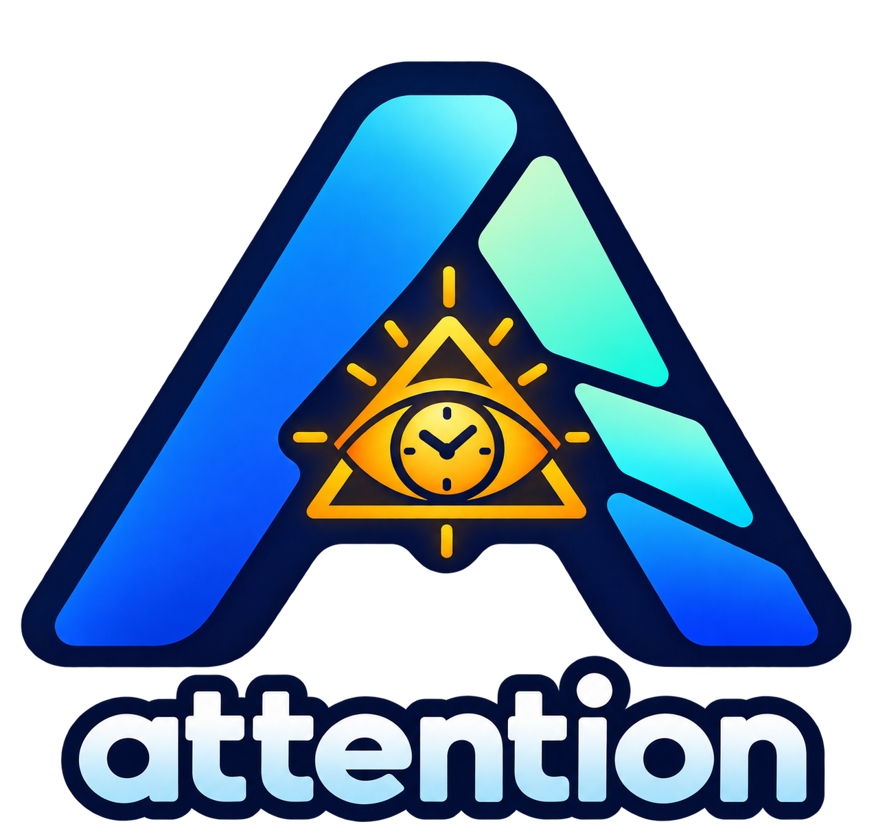

<div align="center">
  
  <h1>Attention</h1>
  <p>以注意力管理为核心的本地优先 Android 时间规划应用。</p>
  <p>
    <a href="https://github.com/magician336/attention/actions/workflows/ci.yml"></a>
    
    
    
  </p>
</div>

## Attention 是什么

Attention 是一个以**注意力管理**为产品核心的 Android 应用。它帮助你把长期目标、日程安排和真实时间投入放进同一个本地时间账本，持续回答一个问题：

> 我的时间，实际投入到了什么地方？

当前版本是 **v0.1.0 早期预览版**，功能和数据格式仍可能变化。

## 核心能力

- **目标树**：用多级目标组织学习、工作和生活计划；支持目标阶段、未来生效规则、移动与归档。
- **时间目标**：支持每日、每周、每月和一次性目标，并保留周期快照、目标缺口和主动迁移记录。
- **日程管理**：创建日程、重复日程和可选本地提醒；日程完成状态不会伪造实际投入。
- **实际投入**：使用全局计时器或手动记录分钟；支持未归属活动、编辑、删除和跨规划日拆分。
- **统计与复盘**：查看日、周、月投入，区分直接投入、子树汇总、目标缺口和超额投入。
- **适度游戏化**：实际投入产生经验、里程碑和等级反馈；未完成计划不会扣经验或降级。
- **本地备份**：导出完整 JSON 备份，或导出 CSV 进行分析；无需账号和网络即可使用核心功能。

## 隐私与数据

- 不需要注册账号。
- 计划、日程、时间记录、提醒、经验和统计默认只保存在设备本地。
- 当前版本不包含广告、行为分析或云同步。
- JSON 是完整恢复格式，CSV 主要用于分析，不用于完整恢复目标树和游戏化数据。

## 快速开始

### 环境要求

- Android Studio 与 JDK 17
- Android SDK 36（用于编译）
- Android 8.0（API 26）或更高版本的设备/模拟器

项目使用 Android API 36 编译并以 API 36 为目标版本；CI 当前在 API 35 模拟器上执行 Android 集成测试。Android API 版本不等同于 HarmonyOS 版本，本项目当前不宣称原生 HarmonyOS 支持。

### 构建 Debug APK

```bash
./gradlew assembleDebug
```

Windows PowerShell：

```powershell
.\gradlew.bat assembleDebug
```

生成文件位于 `app/build/outputs/apk/debug/app-debug.apk`。

### 本地验证

```bash
./gradlew test lintDebug assembleDebug
```

连接 Android 设备或启动模拟器后，可运行：

```bash
./gradlew connectedDebugAndroidTest
```

## 项目结构

```text
app/       Android UI、Room、DataStore、通知和系统适配
domain/    与 Android 无关的目标、时间记录、统计和游戏化领域逻辑
docs/      产品规格、领域词汇、ADR、发布说明和品牌素材
```

领域术语以 [`CONTEXT.md`](CONTEXT.md) 为准。项目中的“计划”“实际投入”“规划日”等词有明确含义，贡献代码和文档时请保持一致。

## 贡献

欢迎围绕可复现的问题和具体改进提出贡献。建议流程：

1. 先提交 Issue，描述使用场景、预期行为和实际行为。
2. 等待方案讨论后再提交 Pull Request。
3. 在 PR 中说明影响范围、验证命令和数据兼容性影响。

请不要在 Issue 或 PR 中上传真实的个人时间记录、备份文件或敏感信息。

## 版本与兼容性

v0.1.0 仍处于早期预览阶段。Room 数据库和备份格式可能继续演进；发布说明会记录重要的数据迁移限制。升级前请保留 JSON 备份。

## 许可证

本项目采用 [Apache License 2.0](LICENSE)。项目依赖的 AndroidX、Kotlin、Jetpack Compose、Room 等组件分别遵循其各自许可证。

---

## English

### What is Attention?

Attention is a local-first Android time planning app built around **attention management**. It brings long-term goals, schedules, and actual time investment into one local time ledger so you can see where your attention really went.

This repository currently contains **v0.1.0, an early preview**. Features and data formats may change.

### Highlights

- Hierarchical goal trees for work, learning, and life plans.
- Daily, weekly, monthly, and one-time time goals.
- Schedules, recurring schedules, and optional local reminders.
- A global timer and manual minute-based time entries.
- Daily, weekly, and monthly statistics with goal rollups.
- Lightweight experience, milestone, and level feedback without penalties.
- Offline JSON backup/restore and CSV export.

### Privacy

No account is required. Core data is stored locally on the device. The current version has no ads, behavioral analytics, or cloud sync.

### Build

The project requires JDK 17 and Android SDK 36 to compile. It targets Android API 36 and declares Android 8.0 (API 26) as the minimum runtime version.

```bash
./gradlew test lintDebug assembleDebug
```

The current CI configuration also runs Android integration tests on an API 35 emulator. This project does not currently claim native HarmonyOS support.

### Contributing and license

Please open an Issue before starting a substantial change, then include the affected behavior and validation results in your Pull Request. Attention is released under the [Apache License 2.0](LICENSE).
